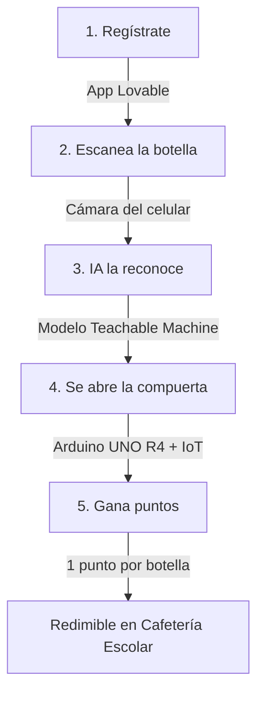
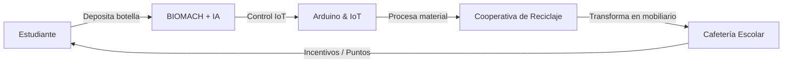

# BioMach ♻️🤖
**Reciclaje inteligente con Inteligencia Artificial e Internet de las Cosas**

Sistema automatizado de recolección de plástico enfocado en fomentar la cultura ambiental y la economía circular en el ámbito escolar, desarrollado por el **Centro de Interés Tecnobot Lisama - Liceo Samario**.

---

## 🧭 Diagrama de Flujo del Sistema (Ciclo de Usuario)

---

## 🔄 Circuito de Economía Circular

---

## 🎯 Objetivos de Desarrollo Sostenible (ODS)
Este proyecto impacta directamente en los siguientes ODS de la Agenda 2030:
- **ODS 4:** Educación de calidad
- **ODS 9:** Industria, innovación e infraestructura
- **ODS 11:** Ciudades y comunidades sostenibles
- **ODS 12:** Producción y consumo responsables
- **ODS 13:** Acción por el clima
- **ODS 17:** Alianzas para lograr los objetivos

---

## 🛠️ Especificaciones de Hardware y Software
- **Microcontrolador:** Arduino UNO R4 (con capacidades IoT).
- **Inteligencia Artificial:** Modelo de reconocimiento de imágenes entrenado en Teachable Machine.
- **Desarrollo Frontend / App:** Plataforma Lovable.
- **Mecanismo:** Compuerta automatizada conectada a actuadores controlados por el microcontrolador.

---

## 📋 Asignación de Pines y Conexiones

| Componente | Función | Pin Arduino UNO R4 | Tipo |
| :--- | :--- | :--- | :--- |
| **Módulo IoT / ESP** | Comunicación Serial / Wi-Fi | Pines TX / RX o I2C | Digital / Bus |
| **Servo / Motor Compuerta** | Apertura de depósito | Pin 9 | PWM |
| **Sensor Presencia / Tapa** | Detección de recipiente lleno | Pin A0 | Digital In |
| **Alimentación Lógica** | VCC / GND | 5V / GND Común | Alimentación |

---

## 👥 Equipo Creador
* **Estudiantes:** Frank Jair Gutierrez Camargo, Shauny Carolina Bailon Perea, Camilo Andres Solano Arce, Maria Sofia Mendoza Ebratt, Juan Jose Diago Quiñones, Flor Marieth De Leon Espino.
* **Docente Líder:** Maria Del Pilar Hernandez Calderon.